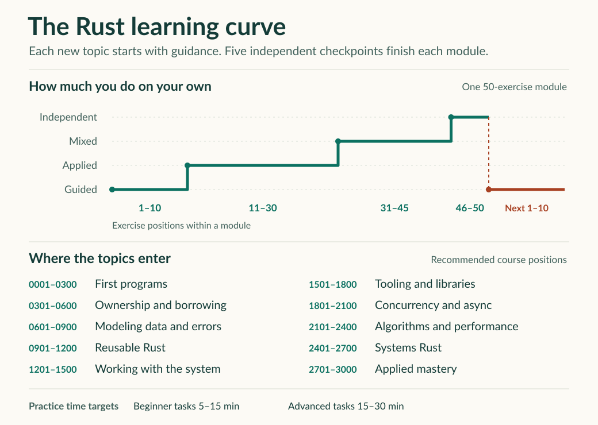

# Learn Rust

Start with [Run your first Rust program](tasks/task-011/PROBLEM.md). You’ll print a message, edit one line, and use a test to check exactly what changed. You can start with an empty programming notebook and a text editor.



## Your first session

Install Rust using [rustup](https://rustup.rs/). Open a terminal in this repository, the folder containing this README. The first Cargo command can take a few minutes to download the course’s pinned compiler.

```sh
cargo track show 11
cargo run --manifest-path tasks/task-011/Cargo.toml
```

The starter prints `Hello!`. Open `tasks/task-011/src/main.rs`, change the greeting to `Hello, Rust!`, save, and run the program again. Now run the public test.

```sh
cargo test --manifest-path tasks/task-011/Cargo.toml --test public
```

When the public test turns green, follow the submission step in the task’s REVIEW.md. Then run the full suite and find your next exercise.

```sh
cargo track test 11
cargo track next 11
```

## Find a lesson

| Command from the repository root | What you get |
|---|---|
| `cargo track list --module "Setup and Cargo"` | The first 50 tasks in learning order |
| `cargo track list E0502` | Exercises about a conflicting borrow |
| `cargo track list tokio --kind debugging` | Tokio repair labs |
| `cargo track show task-001` | The contract, recommended position and direct Cargo commands |
| `cargo track hint 11 1` | The first hint. Levels 2 and 3 offer more detail |
| `cargo track check 11` | Compiler feedback on your current edit |
| `cargo track test 11` | Cargo’s acceptance test results and exit status |
| `cargo track next 11` | The next recommended task |

The [course plan](course/PLAN.md) covers all ten stages. The [learner guide](INSTRUCTION.md) explains submissions, debugging, and checkpoints. The [catalog](course/catalog.tsv) can also be opened as a tab-separated spreadsheet. The original ten package commands still work, including `cargo test -p task_001`.

For a guided tour of the first six modules, open the [beginner walkthrough](course/beginner.md). When you want to compare a completed attempt with a reference, the local `solution` branch holds answer files under `solutions/task-NNN/`. You can read a single answer from your course checkout with `git show solution:solutions/task-011/src/main.rs`.

To browse and test answers beside your own work, create a second checkout.

```sh
git worktree add ../learn-rust-answers solution
cd ../learn-rust-answers
python3 solutions/check.py 11
```
